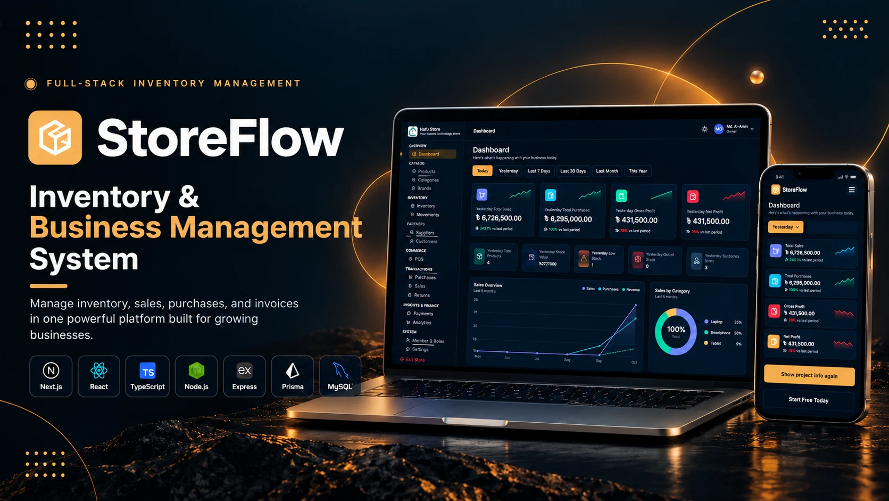

 <div align="left">

# StoreFlow

**Built to manage. Designed to grow.**

A multi-store inventory, POS and invoicing platform with role-based access, real-time updates and sales analytics. Built for Bangladesh, ready for the world.

[**Live Demo**](https://storeflow.alaminhere.com/) · [**Report a Bug**](https://github.com/alaminhere/StoreFlow/issues) · [**Portfolio**](https://alaminhere.com/)




</div>

---

## Live Demo

**[https://storeflow.alaminhere.com/](https://storeflow.alaminhere.com/)**

Explore the full system without signing up. Use the demo account below:

| Field | Value |
|---|---|
| Email | `demo@example.com` |
| Password | `12345` |

After signing in, you will land on the **Store List**. Pick a store to continue:

| Store | Role | Access |
|---|---|---|
| **Store A** | Owner | Full access to every module |
| **Store B** | Manager | Limited, role-based access |

Switch stores anytime from the user menu to see how the menus, permissions and dashboard change with each store and role.

---

## 🧠 Engineering Challenges & Solutions

Building a multi-tenant SaaS platform required solving complex architectural and business logic problems. Here are some of the key technical challenges faced during development and how they were resolved:

**1. Multi-Tenant Data Isolation (ID Collision)**
*   **Challenge:** Initially, custom IDs (e.g., `RET_001`, `SALE_001`) were used as the global Primary Key. This caused constraint errors when two different stores tried to generate the same custom ID.
*   **Solution:** Migrated to **Prisma Composite Primary Keys** (`@@id([storeId, id])`). This ensured strict data isolation, allowing multiple tenants to have the same custom ID format without conflicts, while keeping queries highly optimized.

**2. Complex Accounting Logic (Automated Due Adjustment)**
*   **Challenge:** When a customer returns a product, they might have an existing "Due" (unpaid balance) on a previous sale. Simply refunding cash would result in a loss, as the customer still owes money.
*   **Solution:** Engineered a custom algorithm to calculate `min(dueAmount, refundAmount)`. Created a dedicated `RETURN_ADJUSTMENT` payment method. The system now intelligently offsets the refund against the old due first, and only refunds the remaining balance in cash, keeping the financial ledger 100% accurate.

**3. ACID Transactions & Race Conditions**
*   **Challenge:** Fetching stock levels outside a database transaction led to "Race Conditions" (e.g., two users buying the last item simultaneously), risking negative stock and inaccurate stock movement logs.
*   **Solution:** Wrapped all inventory updates inside `prisma.$transaction`. Implemented atomic `updateMany` operations with `stock: { gte: quantity }` constraints. If the stock drops below the requested amount mid-transaction, the entire process rolls back safely.

**4. Real-Time Cache Invalidation Across Devices**
*   **Challenge:** When a sale or return occurred, related data (customer dues, payment ledgers, and dashboard analytics) remained stale on other active devices (e.g., a manager's dashboard).
*   **Solution:** Built a custom `socketTagMap` integrated with **Socket.IO** and **RTK Query**. When a mutation occurs, the backend emits targeted Socket events, instantly invalidating specific RTK Query cache tags on all connected clients for a zero-reload, real-time experience.

**5. Missing Initial Payment Ledger**
*   **Challenge:** While partial payments (advance payments) were saved to the main Sale/Purchase table, they were not being recorded in the dedicated `Payment` tables. This caused discrepancies in the payment history UI.
*   **Solution:** Implemented conditional transactional logic to create a `salePayment` or `purchasePayment` record if `paid > 0` during the initial creation. This ensured the financial ledger was comprehensive and accurate from day one.

---
##  Current Features

### 🏦 1. Accounting, Finance & Payments

-  **Smart Return & Due Adjustment:** Automatically adjust refunds against existing customer/supplier dues.
- **Partial & Split Payments:** Support for multiple payment methods (Cash, bKash, Bank, Card) with partial payment tracking.
- **Profit Tracking:** Real-time calculation of Gross Profit and Net Profit with period-over-period comparison.
- **Financial Analytics:** Track total sales, total purchases, and stock valuation in real-time.
- **Subscription & Billing Plans:** Built-in tiered plans for SaaS billing.
- **Usage Limits & Quotas:** Restrict stores based on plan limits.

### 📦 2. Advanced Inventory & Stock

- **Stock Movement Ledger:** Complete, auditable history of every stock IN/OUT with reason tracking.
- **Auto Stock Updates:** Stock levels automatically increment on purchases and decrement on sales/returns.
- **Low & Out of Stock Alerts:** Dashboard cards and visual warnings for items hitting minimum stock levels.
- **Barcode Integration:** Add, manage, and scan product barcodes for fast POS checkout.
- **Soft Delete & Auto-Restore:** Safely delete and restore products, categories, and brands without losing historical data.

### 🛒 3. Sales, POS & CRM

- **Flexible Pricing & Discounts:** Sell the same product at different prices (wholesale/retail) with custom discounts applied at POS.
- **PDF Invoice Generation (Email):** Download and email professional invoices directly to customers and suppliers.
- **Sales Overview:** Track total sales, purchases, and revenue trends over the last 6 months.
- **Category-wise Analytics:** Visual donut chart showing sales distribution across different product categories.

### 🏢 4. Multi-Tenancy & Access Control

- **Global User System:** One account can manage and switch between multiple stores seamlessly.
- **Role-Based Access Control (RBAC):** Granular permissions for Owner, Admin, Manager, and Salesman.
- **Composite Key Isolation:** True multi-tenant data isolation using `storeId + id` composite primary keys.
- **Dynamic Dashboard:** Metrics and charts automatically update based on the selected store and time filter.

### 🔐 5. System, Security & Audit

- **Real-Time Updates:** Instant data sync across all active devices using Socket.IO.
- **Automated Database Backup:** Daily automated DB backups with download option.
- **Two-Factor Authentication (2FA):** Enhanced security with OTP or Google Authenticator support.
- **Advanced Data Filtering:** Dashboard filters for Today, Yesterday, Last 7 Days, Last 30 Days, Last Month, and This Year.

### 📊 6. Advanced Analytics

- **Interactive Dashboard:** Live KPI cards for Total Sales, Purchases, Gross/Net Profit, Total Products, Stock Value, Customers, and Suppliers.
- **Visual Reports:** Beautiful line charts and donut charts powered by Chart.js.
- **Movement Analysis:** Deep-dive into inventory flow and stock adjustments.

---

## Tech Stack

| Frontend | Backend and Services |
|---|---|
| Next.js 16 (App Router) | Node.js and Express 5 |
| React 19 | Prisma ORM with MariaDB adapter |
| TypeScript | MySQL / MariaDB |
| Tailwind CSS 4 | Socket.IO |
| Redux Toolkit / RTK Query | JWT and bcrypt |
| React Hook Form | Zod |
| Chart.js | express-rate-limit and CORS |
| jsPDF and jsPDF AutoTable | Cloudinary and Multer |
| next-themes | Resend |
| SweetAlert2 | Slugify and Day.js |

---


## Architecture

```text
┌──────────────────────┐        HTTPS (JSON + cookies)        ┌───────────────────────┐
│  Next.js frontend    │ ───────────────────────────────────▶ │  Express 5 API        │
│  RTK Query + RHF     │ ◀─────────────────────────────────── │  Zod · JWT · Limiters │
│  storeflow.*         │            Socket.IO (WS)            │  api.storeflow.*      │
└──────────────────────┘                                      └──────────┬────────────┘
                                                                         │ Prisma
                                                     ┌───────────────────┼───────────────────┐
                                                     ▼                   ▼                   ▼
                                               MySQL / MariaDB       Cloudinary            Resend
                                               (stores, stock,       (product images)      (verification
                                                sales, users)                               and reset emails)
```

---

## Project Structure

```text
StoreFlow/
├── frontend/    # Next.js application
└── backend/     # Express API
```

---

## Getting Started

### Prerequisites

- Node.js 20 or newer
- A MySQL or MariaDB database
- Cloudinary and Resend accounts for images and email

### 1. Clone the repository

```bash
git clone https://github.com/alaminhere/StoreFlow.git
cd StoreFlow
```

### 2. Set up the backend

```bash
cd backend
npm install
```

Create `backend/.env` (see [Environment Variables](#environment-variables)), then run:

```bash
npx prisma generate
npx prisma migrate dev
npm run dev
```

The API starts on `http://localhost:8000`.

### 3. Set up the frontend

```bash
cd ../frontend
npm install
```

Create `frontend/.env` (see below), then run:

```bash
npm run dev
```

Open `http://localhost:3000` in your browser.

---

## Environment Variables

### Backend (`backend/.env`)

```env
CLIENT_URL="http://localhost:3000"
COOKIE_DOMAIN=

DATABASE_URL=
DATABASE_HOST=
DATABASE_PORT=
DATABASE_USER=
DATABASE_PASSWORD=
DATABASE_NAME=

JWT_SECRET=
JWT_ACCESS_EXPIRATION_MINUTES=

CLOUDINARY_CLOUD_NAME=
CLOUDINARY_API_KEY=
CLOUDINARY_API_SECRET=

RESEND_API_KEY=
EMAIL_FROM=
```

### Frontend (`frontend/.env`)

```env
NEXT_PUBLIC_API_URL="http://localhost:8000/api/v1"
NEXT_PUBLIC_SOCKET_URL="http://localhost:8000"
NEXT_PUBLIC_SITE_URL="http://localhost:3000"

NEXT_PUBLIC_CLOUD_NAME=
NEXT_PUBLIC_PRESET_NAME=

CLOUDINARY_CLOUD_NAME=
CLOUDINARY_API_KEY=
CLOUDINARY_API_SECRET=


```

---

## Scripts

| Location | Command | Description |
|---|---|---|
| `backend` | `npm run dev` | Start the API with hot reload (tsx) |
| `backend` | `npm run build` | Generate the Prisma client and build |
| `backend` | `npm start` | Run the production build |
| `frontend` | `npm run dev` | Start the Next.js dev server |
| `frontend` | `npm run build` | Create a production build |
| `frontend` | `npm start` | Serve the production build |
| `frontend` | `npm run lint` | Run ESLint |

---

## Deployment Notes

- Set `NODE_ENV=production` on the backend.
- Set `CLIENT_URL` to your frontend origin without a trailing slash, for example `https://storeflow.alaminhere.com`.
- Set `COOKIE_DOMAIN` to the shared parent domain so cookies work across the frontend and API subdomains.
- Enable `trust proxy` behind Nginx, Cloudflare or a similar proxy, so rate limiting sees real client IPs.

---

## Author

**Md. Al-Amin**, Full-Stack Developer

[Portfolio](https://alaminhere.com/) · [LinkedIn](https://www.linkedin.com/in/alamin-here) · [GitHub](https://github.com/alaminhere)

---

## License

This project is licensed under the **MIT License**.

---

<div align="center">

If you found this project helpful, consider giving it a ⭐ on GitHub.

</div>
