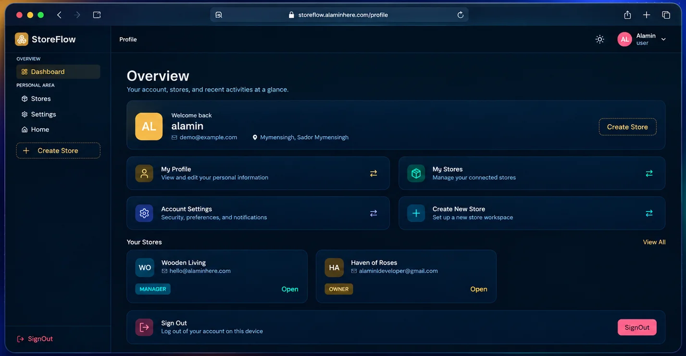
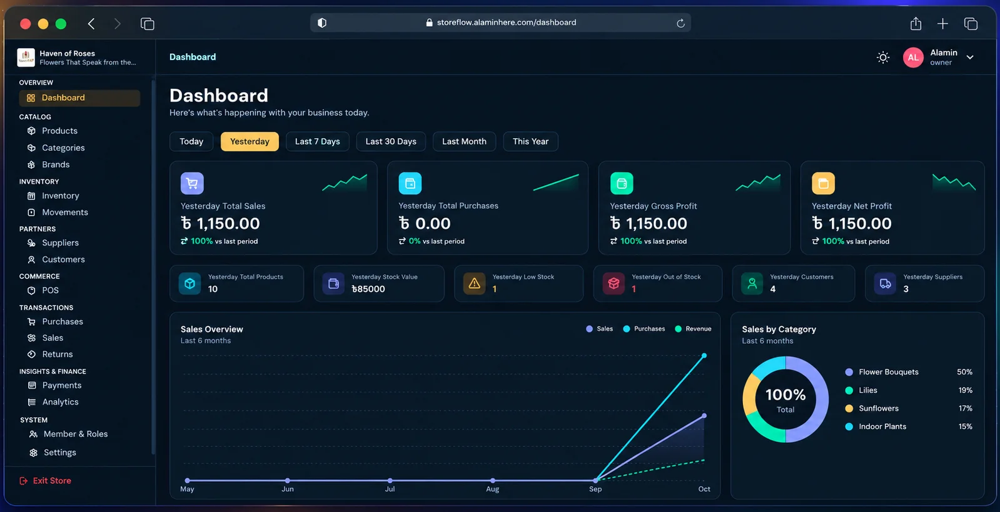
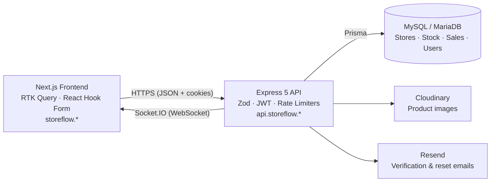

<div align="left">

# StoreFlow

### Built to manage. Designed to grow.

A multi-store inventory, POS and invoicing platform with role-based access, real-time updates and sales analytics. Built for Bangladesh, ready for the world.

[**Live Demo**](https://storeflow.alaminhere.com/) · [**Report a Bug**](https://github.com/alaminhere/StoreFlow/issues) · [**Portfolio**](https://alaminhere.com/)


<br />




<br />

**Multi-Tenant** &nbsp;·&nbsp; **POS & Invoicing** &nbsp;·&nbsp; **RBAC** &nbsp;·&nbsp; **Real-Time Sync** &nbsp;·&nbsp; **Sales Analytics**

</div>

---

## Table of Contents

- [Engineering Challenges & Solutions](#engineering-challenges--solutions)
- [Current Features](#current-features)
- [Tech Stack](#tech-stack)
- [Architecture](#architecture)
- [Project Structure](#project-structure)
- [Getting Started](#getting-started)
- [Environment Variables](#environment-variables)
- [Scripts](#scripts)

---

## Live Demo

**[https://storeflow.alaminhere.com/](https://storeflow.alaminhere.com/)**

Explore the full system without signing up. Use the demo account below:

| Field | Value |
|---|---|
| Email | `demo@example.com` |
| Password | `12345` |

After signing in, you will land on the **Store List**. Pick a store to continue:

| Store | Role | Access |
|---|---|---|
| **Store A** | Owner | Full access to every module |
| **Store B** | Manager | Limited, role-based access |

> Switch stores anytime from the user menu to see how the menus, permissions and dashboard change with each store and role.

---

## Engineering Challenges & Solutions

Building a multi-tenant SaaS platform required solving complex architectural and business logic problems. These are the key technical challenges faced during development and how they were resolved.

### 1. Multi-Tenant Data Isolation (ID Collision)

| | |
|---|---|
| **Challenge** | Custom IDs (e.g., `RET_001`, `SALE_001`) were initially used as the global Primary Key. This caused constraint errors when two different stores tried to generate the same custom ID. |
| **Solution** | Migrated to **Prisma Composite Primary Keys** (`@@id([storeId, id])`). This ensured strict data isolation, allowing multiple tenants to share the same custom ID format without conflicts, while keeping queries highly optimized. |

### 2. Complex Accounting Logic (Automated Due Adjustment)

| | |
|---|---|
| **Challenge** | When a customer returns a product, they might have an existing "Due" (unpaid balance) on a previous sale. Simply refunding cash would result in a loss, as the customer still owes money. |
| **Solution** | Engineered a custom algorithm to calculate `min(dueAmount, refundAmount)` and created a dedicated `RETURN_ADJUSTMENT` payment method. The system offsets the refund against the old due first, and only refunds the remaining balance in cash, keeping the financial ledger 100% accurate. |

### 3. ACID Transactions & Race Conditions

| | |
|---|---|
| **Challenge** | Fetching stock levels outside a database transaction led to race conditions (e.g., two users buying the last item simultaneously), risking negative stock and inaccurate stock movement logs. |
| **Solution** | Wrapped all inventory updates inside `prisma.$transaction` and implemented atomic `updateMany` operations with `stock: { gte: quantity }` constraints. If stock drops below the requested amount mid-transaction, the entire process rolls back safely. |

### 4. Real-Time Cache Invalidation Across Devices

| | |
|---|---|
| **Challenge** | When a sale or return occurred, related data (customer dues, payment ledgers, and dashboard analytics) remained stale on other active devices, such as a manager's dashboard. |
| **Solution** | Built a custom `socketTagMap` integrated with **Socket.IO** and **RTK Query**. When a mutation occurs, the backend emits targeted socket events that instantly invalidate specific RTK Query cache tags on all connected clients, for a zero-reload, real-time experience. |

### 5. Missing Initial Payment Ledger

| | |
|---|---|
| **Challenge** | Partial payments (advance payments) were saved to the main Sale/Purchase table but not recorded in the dedicated `Payment` tables. This caused discrepancies in the payment history UI. |
| **Solution** | Implemented conditional transactional logic to create a `salePayment` or `purchasePayment` record when `paid > 0` during initial creation. The financial ledger is now comprehensive and accurate from day one. |

---

## Current Features

### 🏦 Accounting, Finance & Payments

| Feature | Description |
|---|---|
| **Smart Return & Due Adjustment** | Automatically adjust refunds against existing customer/supplier dues |
| **Partial & Split Payments** | Multiple payment methods (Cash, bKash, Bank, Card) with partial payment tracking |
| **Profit Tracking** | Real-time Gross Profit and Net Profit with period-over-period comparison |
| **Financial Analytics** | Track total sales, total purchases, and stock valuation in real time |
| **Subscription & Billing Plans** | Built-in tiered plans for SaaS billing |
| **Usage Limits & Quotas** | Restrict stores based on plan limits |

### 📦 Advanced Inventory & Stock

| Feature | Description |
|---|---|
| **Stock Movement Ledger** | Complete, auditable history of every stock IN/OUT with reason tracking |
| **Auto Stock Updates** | Stock increments on purchases and decrements on sales/returns |
| **Low & Out of Stock Alerts** | Dashboard cards and visual warnings for items hitting minimum stock levels |
| **Barcode Integration** | Add, manage, and scan product barcodes for fast POS checkout |
| **Soft Delete & Auto-Restore** | Safely delete and restore products, categories, and brands without losing historical data |

### 🛒 Sales, POS & CRM

| Feature | Description |
|---|---|
| **Flexible Pricing & Discounts** | Sell the same product at different prices (wholesale/retail) with custom discounts at POS |
| **PDF Invoice Generation (Email)** | Download and email professional invoices directly to customers and suppliers |
| **Sales Overview** | Track total sales, purchases, and revenue trends over the last 6 months |
| **Category-wise Analytics** | Donut chart showing sales distribution across product categories |

### 🏢 Multi-Tenancy & Access Control

| Feature | Description |
|---|---|
| **Global User System** | One account can manage and switch between multiple stores seamlessly |
| **Role-Based Access Control (RBAC)** | Granular permissions for Owner, Admin, Manager, and Salesman |
| **Composite Key Isolation** | True multi-tenant data isolation using `storeId + id` composite primary keys |
| **Dynamic Dashboard** | Metrics and charts update automatically based on the selected store and time filter |

### 🔐 System, Security & Audit

| Feature | Description |
|---|---|
| **Real-Time Updates** | Instant data sync across all active devices using Socket.IO |
| **Automated Database Backup** | Daily automated database backups with download option |
| **Two-Factor Authentication (2FA)** | Enhanced security with OTP or Google Authenticator support |
| **Advanced Data Filtering** | Dashboard filters for Today, Yesterday, Last 7 Days, Last 30 Days, Last Month, and This Year |

### 📊 Advanced Analytics

| Feature | Description |
|---|---|
| **Interactive Dashboard** | Live KPI cards for Total Sales, Purchases, Gross/Net Profit, Total Products, Stock Value, Customers, and Suppliers |
| **Visual Reports** | Line charts and donut charts powered by Chart.js |
| **Movement Analysis** | Deep-dive into inventory flow and stock adjustments |

---

## Tech Stack

| Frontend | Backend & Services |
|---|---|
| Next.js 16 (App Router) | Node.js and Express 5 |
| React 19 | Prisma ORM with MariaDB adapter |
| TypeScript | MySQL / MariaDB |
| Tailwind CSS 4 | Socket.IO |
| Redux Toolkit / RTK Query | JWT and bcrypt |
| React Hook Form | Zod |
| Chart.js | express-rate-limit and CORS |
| jsPDF and jsPDF AutoTable | Cloudinary and Multer |
| next-themes | Resend |
| SweetAlert2 | Slugify and Day.js |

---

## Architecture



---

## Project Structure

```text
StoreFlow/
├── frontend/    # Next.js application
└── backend/     # Express API
```

---

## Getting Started

### Prerequisites

- Node.js 20 or newer
- A MySQL or MariaDB database
- Cloudinary and Resend accounts for images and email

### 1. Clone the repository

```bash
git clone https://github.com/alaminhere/StoreFlow.git
cd StoreFlow
```

### 2. Set up the backend

```bash
cd backend
npm install
```

Create `backend/.env` (see [Environment Variables](#environment-variables)), then run:

```bash
npx prisma generate
npx prisma migrate dev
npm run dev
```

The API starts on `http://localhost:8000`.

### 3. Set up the frontend

```bash
cd ../frontend
npm install
```

Create `frontend/.env` (see [Environment Variables](#environment-variables)), then run:

```bash
npm run dev
```

Open `http://localhost:3000` in your browser.

---

## Environment Variables

### Backend (`backend/.env`)

| Variable | Description |
|---|---|
| `CLIENT_URL` | Frontend origin, e.g. `http://localhost:3000` |
| `COOKIE_DOMAIN` | Shared parent domain for cookies |
| `DATABASE_URL` | Full database connection string |
| `DATABASE_HOST` · `DATABASE_PORT` | Database host and port |
| `DATABASE_USER` · `DATABASE_PASSWORD` | Database credentials |
| `DATABASE_NAME` | Database name |
| `JWT_SECRET` | Secret used to sign JWTs |
| `JWT_ACCESS_EXPIRATION_MINUTES` | Access token lifetime in minutes |
| `CLOUDINARY_CLOUD_NAME` · `CLOUDINARY_API_KEY` · `CLOUDINARY_API_SECRET` | Cloudinary Console → Dashboard |
| `RESEND_API_KEY` | Resend Dashboard → API Keys |
| `EMAIL_FROM` | Sender address for emails |

<details>
<summary><b>Copy-paste template</b></summary>

```env
CLIENT_URL="http://localhost:3000"
COOKIE_DOMAIN=

DATABASE_URL=
DATABASE_HOST=
DATABASE_PORT=
DATABASE_USER=
DATABASE_PASSWORD=
DATABASE_NAME=

JWT_SECRET=
JWT_ACCESS_EXPIRATION_MINUTES=

CLOUDINARY_CLOUD_NAME=
CLOUDINARY_API_KEY=
CLOUDINARY_API_SECRET=

RESEND_API_KEY=
EMAIL_FROM=
```

</details>

### Frontend (`frontend/.env`)

| Variable | Description |
|---|---|
| `NEXT_PUBLIC_API_URL` | Backend API base URL, e.g. `http://localhost:8000/api/v1` |
| `NEXT_PUBLIC_SOCKET_URL` | Socket.IO server URL, e.g. `http://localhost:8000` |
| `NEXT_PUBLIC_SITE_URL` | Frontend site URL, e.g. `http://localhost:3000` |
| `NEXT_PUBLIC_CLOUD_NAME` · `NEXT_PUBLIC_PRESET_NAME` | Cloudinary cloud name and upload preset |
| `CLOUDINARY_CLOUD_NAME` · `CLOUDINARY_API_KEY` · `CLOUDINARY_API_SECRET` | Cloudinary Console → Dashboard |

<details>
<summary><b>Copy-paste template</b></summary>

```env
NEXT_PUBLIC_API_URL="http://localhost:8000/api/v1"
NEXT_PUBLIC_SOCKET_URL="http://localhost:8000"
NEXT_PUBLIC_SITE_URL="http://localhost:3000"

NEXT_PUBLIC_CLOUD_NAME=
NEXT_PUBLIC_PRESET_NAME=

CLOUDINARY_CLOUD_NAME=
CLOUDINARY_API_KEY=
CLOUDINARY_API_SECRET=
```

</details>

---

## Scripts

| Location | Command | Description |
|---|---|---|
| `backend` | `npm run dev` | Start the API with hot reload (tsx) |
| `backend` | `npm run build` | Generate the Prisma client and build |
| `backend` | `npm start` | Run the production build |
| `frontend` | `npm run dev` | Start the Next.js dev server |
| `frontend` | `npm run build` | Create a production build |
| `frontend` | `npm start` | Serve the production build |
| `frontend` | `npm run lint` | Run ESLint |

---

## Deployment Notes

| Setting | Recommendation |
|---|---|
| `NODE_ENV` | Set to `production` on the backend |
| `CLIENT_URL` | Your frontend origin without a trailing slash, e.g. `https://storeflow.alaminhere.com` |
| `COOKIE_DOMAIN` | The shared parent domain, so cookies work across the frontend and API subdomains |
| `trust proxy` | Enable behind Nginx, Cloudflare or a similar proxy, so rate limiting sees real client IPs |

---

## Author

**Md. Al-Amin**, Full-Stack Developer

[Portfolio](https://alaminhere.com/) · [LinkedIn](https://www.linkedin.com/in/alamin-here) · [GitHub](https://github.com/alaminhere)

---

## License

This project is licensed under the **MIT License**.

---

<div align="center">

If you found this project helpful, consider giving it a ⭐ on GitHub.

</div>